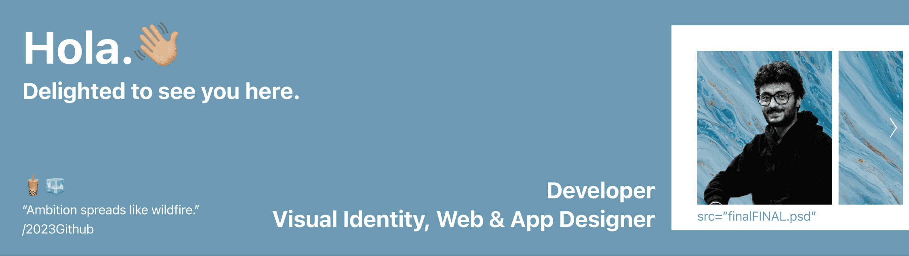
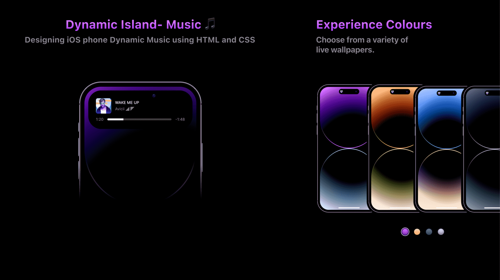
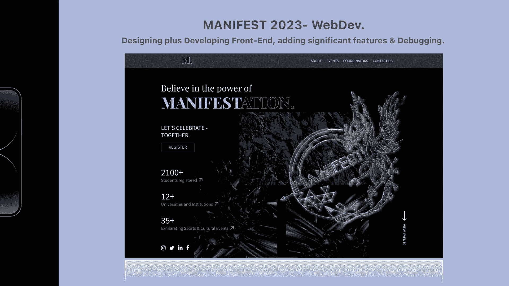

<!-- ******************************************************************* BANNER IMAGE ************************************************************* -->

<!--  -->

<!-- ************************************************************************ ABOUT ME ********************************************************** -->
## About:

anything that is huge, profitable, famous, or influential is the result of a tail event -morgan

| Technology | Development | Design | Books | Photography | Expeditions | Interactions |

<!-- *********************************************************************** LINKS ************************************************************ -->

## Socials:
[Web](https://ritikbalwant.github.io)<tab>
[Linkedin](www.linkedin.com/in/ritikbalwant)<tab>
[Medium](https://medium.com/@ritikbalwant) <tab>
[Twitter](https://twitter.com/RitikBalwant) <tab>
<!-- [Instagram](https://www.instagram.com/ritikbalwant129) -->

<!-- 
## Tech Course Reflections
<a href="https://github.com/ritikbalwant/1.Open.Source.Software.Development.methods">Open Source Software Development Methods</a> 4th Jan '23 (6 min read)  
<a href="https://github.com/ritikbalwant/2.Version.Control.git">Version Control</a> 6th May '23 (10 min read)   -->

<!-- ******************************************************************** PROJECTS *************************************************************** -->
<!-- ## A glimpse of projects I've worked on:
   -->

<!-- 
## Project repo:
Dynamic Island Music <a href=""> in dev </a>  
LabMatrix <a href=""> in dev </a>  
N-Clone <a href=""> in dev </a> -->

<!-- ************************************************************** GITHUB STATS *************************************************************** -->
 <!--
          
<h3> My Github Stats: </h3>

 

 
          
    -->
  
 <!-- ************************************************************* EXTRA TOOLS **************************************************************** -->

<!--  -->
<!--  -->
